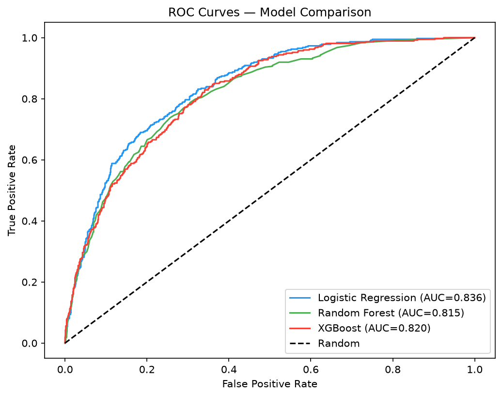
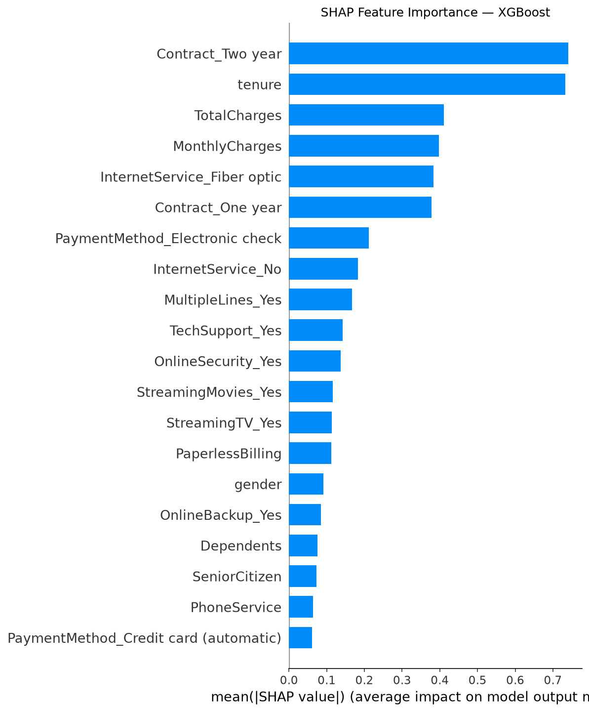
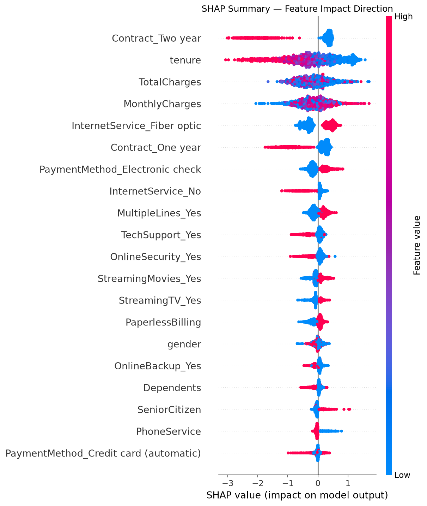

# Customer Churn Predictor

**Live demo:** https://churn-predictor01.streamlit.app/

End-to-end ML pipeline predicting customer churn using the IBM Telco dataset, with three-model comparison, SHAP explainability, and a live prediction dashboard.

## What it does
- Predicts churn probability for any customer profile in real time
- Compares Logistic Regression, Random Forest, and XGBoost
- Explains predictions using SHAP feature importance
- Flags customers as high, medium, or low churn risk

## Results
| Model | AUC | F1 |
|---|---|---|
| Logistic Regression | 0.84 | 0.59 |
| Random Forest | 0.83 | 0.57 |
| XGBoost | 0.84 | 0.61 |

## What drives churn (SHAP)

## Tech stack
| Component | Tool |
|---|---|
| Models | XGBoost, Random Forest, Logistic Regression |
| Explainability | SHAP |
| EDA | Pandas, Seaborn, Matplotlib |
| Feature engineering | Scikit-learn |
| Dashboard | Streamlit |
| Dataset | IBM Telco Customer Churn (7,043 rows) |

## Setup

    git clone https://github.com/adityabandal21/churn-predictor.git
    cd churn-predictor
    python3.11 -m venv venv
    source venv/bin/activate
    pip install -r requirements.txt

On macOS, XGBoost also needs the OpenMP library:

    brew install libomp

## Run

Trained models are already included in `models/`, so you can launch the dashboard directly:

    python -m streamlit run app.py

To retrain the models from scratch:

    cd notebooks
    python -m jupyter nbconvert --to notebook --execute 01_eda.ipynb --output 01_eda.ipynb
    python -m jupyter nbconvert --to notebook --execute 02_model.ipynb --output 02_model.ipynb
    cd ..

## Key findings
- 26.5% churn rate: the dataset is imbalanced, so F1 is more meaningful than accuracy
- Month-to-month contracts have 3x higher churn than two-year contracts
- Fiber optic customers churn more despite paying premium prices
- Short tenure is the strongest churn signal: newer customers are highest risk
- SHAP confirms tenure, MonthlyCharges, and Contract type as top drivers

## Skills demonstrated
EDA, feature engineering, model comparison, XGBoost, SHAP explainability, Scikit-learn, Streamlit deployment, imbalanced classification
